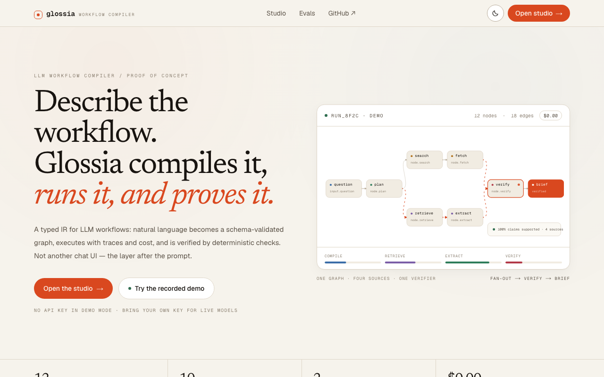
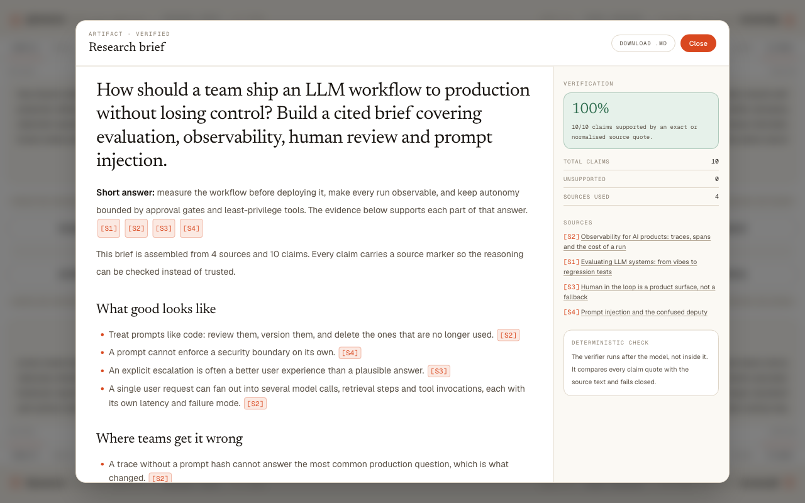
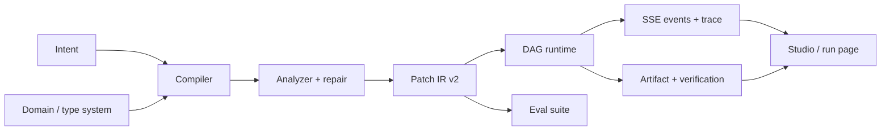
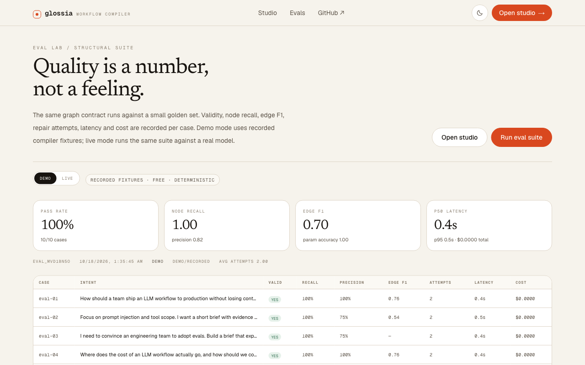
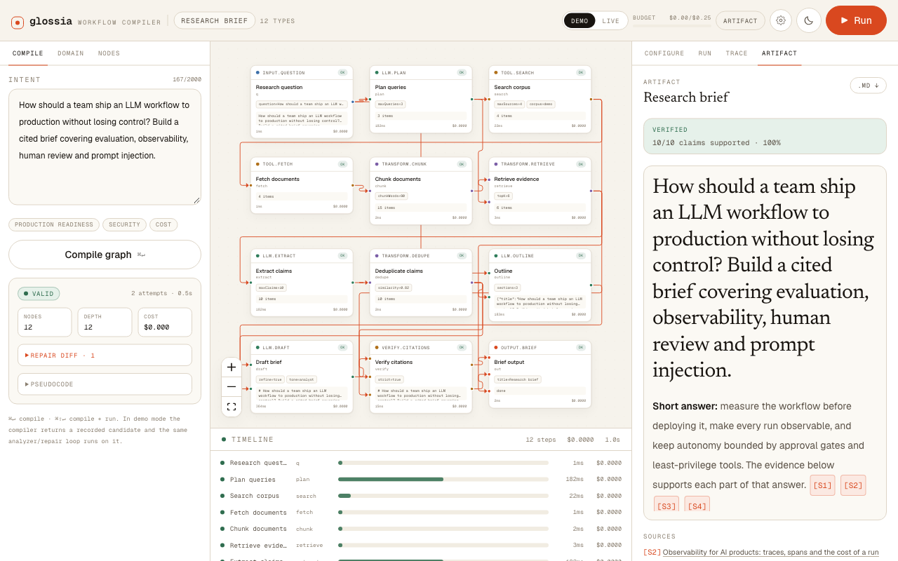
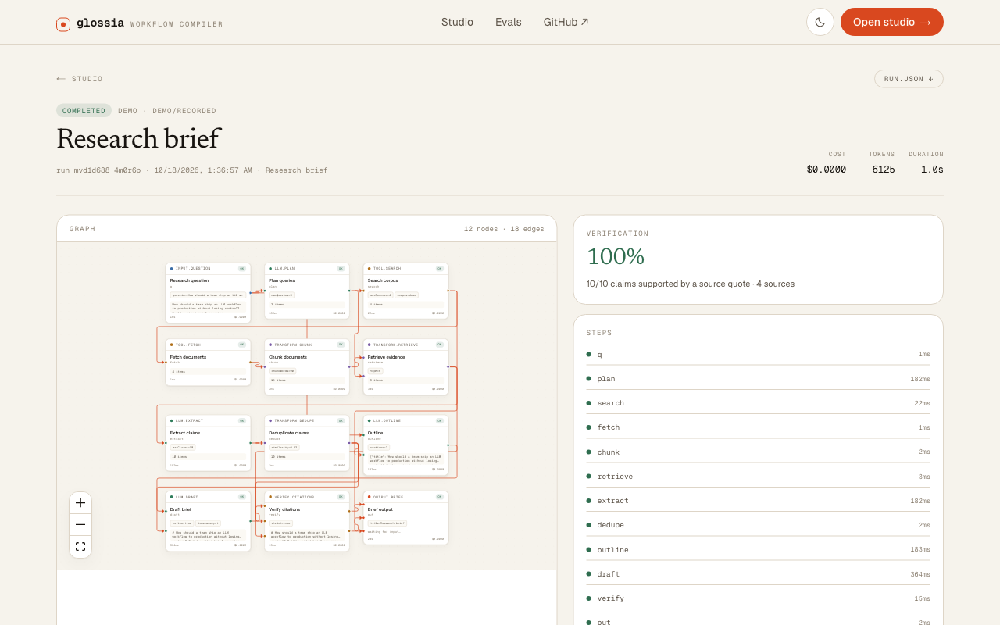

# Glossia

**Compile intent into a runnable LLM workflow — then prove it works.**

Glossia is a proof of concept by [Alessandro Miracapillo](https://github.com/aylesim) for treating an LLM workflow as a **typed program**, not a prompt chain: natural language becomes a schema-validated graph, the graph executes with real inputs and outputs, and every run leaves a trace, a cost and a verification report.

> LLMs propose. The system disposes.



---

## The three acts

| Act | What happens | What it demonstrates |
|-----|--------------|----------------------|
| **Compile** | Intent → typed graph → deterministic analysis → repair | Structured generation, JSON Schema, graph validation |
| **Run** | DAG scheduler, SSE events, retries, budget, cancellation, cache | Orchestration and failure handling |
| **Prove** | Trace spans, token/cost accounting, citation verification, eval suite | Measurement instead of vibes |

The app has three surfaces: a landing page, a studio (`/studio`), and an eval lab (`/eval`). A completed run is also a shareable read-only page (`/runs/[id]`).

## The hero recipe

The default domain is a **research brief with verifiable citations**:

```text
question → plan queries → search corpus → fetch → chunk → retrieve evidence
        → extract claims → dedupe → outline → draft (draft + critique/revise)
        → verify citations → brief
```

The graph is a DAG. Bounded loops (draft → critique → revise) live **inside a composite node**, so the scheduler stays simple and debuggable.

What makes the artifact different from a generic RAG demo:

- Every claim carries an **exact quote** from a source.
- A deterministic verifier checks each quote against the source text after the model runs.
- The report shows supported/unsupported claims, support rate and sources used.
- Unsupported claims are visible, not silently smoothed over.



The demo uses a **curated four-document corpus** so it is deterministic, cheap and offline-friendly. The LLM calls are real in live mode; only the corpus is local.

## Try it

```bash
npm install
npm run dev
```

Open [http://localhost:3000](http://localhost:3000).

1. Click **Open the studio**.
2. Keep **Demo** mode (no API key).
3. Click **Compile graph** — the compiler returns a recorded candidate, the analyzer catches an invalid param, and the repair pass fixes the missing edge.
4. Click **Run** — watch the nodes move, then inspect the artifact, the trace, the cost and the per-step outputs.
5. Click **Run** again — the content-addressed cache returns the whole graph in milliseconds.
6. Open `/eval` and run the 10-case structural suite.

### Live mode

Switch **Demo → Live** in the studio settings, choose a provider and model, and paste a key. The key stays in the tab's `sessionStorage` and is sent only with the generation request; it is never persisted or logged.

You can also provide server-side defaults:

```env
LLM_PROVIDER=openai
OPENAI_API_KEY=sk-...
OPENAI_MODEL=gpt-4.1-mini

# or
LLM_PROVIDER=openrouter
OPENROUTER_API_KEY=...
OPENROUTER_MODEL=openai/gpt-4.1-mini
```

Any OpenAI-compatible endpoint works, including Ollama, vLLM or a local mock:

```env
OPENAI_BASE_URL=http://127.0.0.1:4010/v1
OPENAI_API_KEY=test
OPENAI_MODEL=gpt-4.1-mini
```

There is a local mock provider for exercising the live path without a key:

```bash
npm run mock:llm
# in another shell:
OPENAI_BASE_URL=http://127.0.0.1:4010/v1 OPENAI_API_KEY=test npm run dev
```

The mock is a development fixture. It deliberately returns an invalid candidate on the first compile and a corrected one on repair, so the live repair loop is exercised too.

## Architecture



```text
lib/
  ir/          types, Zod schemas, analyzer, layout, diff, domains
  llm/         adapter, mock/demo adapter, prompts, repair, model registry
  runtime/     budget, cache, DAG executor, node executors, event store
  research/    corpus, retrieval, claim synthesis, deterministic verification
  eval/        golden set, metrics, report runner
app/
  studio/      canvas, inspector, timeline, settings, artifact modal
  eval/        eval lab
  runs/[id]/   read-only run page
  api/         compile, runs, SSE, cancel, eval, models, health
```

### The IR

A domain is a small type system:

```ts
type Domain = {
  id: string;
  version: string;
  nodeTypes: {
    id: string;
    category: "input" | "llm" | "tool" | "transform" | "control" | "output";
    inputs: Port[];      // name, type, required, multi
    outputs: Port[];
    params: ParamSpec[]; // type, required, default, enum, min/max
    executor: { kind: string; ref: string };
  }[];
};
```

A patch is a program in that language: node instances with params and edges that name both ports. The analyzer checks identity, domain membership, param types/ranges, edge endpoints, port types, required inputs, multiple producers, cycles, reachability, dead ends, size limits and estimated cost. Invalid graphs never render and never run.

The repair loop gets the exact issue list and the original output, and returns a full corrected patch. Every attempt is recorded. A deterministic autofix handles the cheap failures first: missing envelope fields, unknown params, numeric strings, duplicate edges.

### The runtime

- Topological scheduling with configurable concurrency.
- Port-level values, fan-out and `multi` fan-in.
- Per-node retries, timeouts and `AbortController` cancellation.
- Budgets in dollars, tokens, wall time and steps; a violated budget stops the run and keeps the partial trace.
- Content-addressed cache keyed by executor, params, resolved inputs, model and cache version. Editing one node re-runs only what changed.
- Typed SSE events with sequence numbers and `Last-Event-ID` replay.
- Traces as spans: node, LLM call, validation and repair. Cost comes from provider usage, not from a guess.

### The evidence

The verifier normalises both the claim quote and the source text, then checks containment. It records the method (`exact_quote`, `normalized_quote`, `missing`). The artifact's confidence statement is derived from that report.

## Eval lab

The suite is structural, not a leaderboard: it checks whether the compiler produced a valid graph with the expected steps and data-flow shape.

| Metric | What it means | Latest demo suite |
|--------|---------------|-------------------|
| pass rate | valid graph and ≥ 60% node recall | **100%** (10/10) |
| node recall | expected node types present | **1.00** |
| node precision | generated types that were expected | **0.82** |
| edge F1 | multiset of `(fromType, toType)` | **0.70** |
| param accuracy | expected params match | **1.00** |
| attempts | compile calls including repair | **2.00** |
| p50 latency | per compile | **0.4s** |
| cost | per suite | **$0.00** in demo |

Demo mode uses recorded compiler fixtures, so these numbers prove the pipeline and the analyzer, not the model. Live mode runs the same cases against a real model and records the real cost and latency.



## Tests

```bash
npm run lint
npm run typecheck
npm run test:ci      # build + production server + API integration tests
```

`test:ci` starts the production server on port 3100 and runs `tests/api.test.mjs`. The tests cover compile + repair, a complete run with verification, cache hits, the 10-case eval suite, invalid graph rejection and cancellation. The local mock provider keeps the live adapter path testable without spending money.

To include the live adapter path in the test run:

```bash
npm run mock:llm
OPENAI_BASE_URL=http://127.0.0.1:4010/v1 OPENAI_API_KEY=test npm start -p 3101
TEST_LIVE=1 TEST_BASE_URL=http://127.0.0.1:3101 npm run test:api
```

## Tradeoffs and limits

This is a focused POC, not a production platform. The important boundaries are explicit:

- **Run registry is in-process.** `globalThis` keeps the POST route and the SSE route on the same run map. A multi-instance deployment needs a real event bus (Redis Streams, Postgres `LISTEN/NOTIFY`, etc.). The store interface is the seam.
- **Runs are files** under `.data/` (gitignored). Good for a single-node demo; replace with a database before sharing across instances.
- **The corpus is curated.** The retrieval path is real (chunking, lexical ranking, top-K, source diversity), but it is not a live web search or PDF ingestion pipeline.
- **The demo compiler is recorded.** It exercises the same analyzer and repair loop as live mode. The live compiler is the real path.
- **No auth, tenancy or billing.** BYOK is deliberate for a POC.
- **Eval is structural.** There is no calibrated LLM judge yet; the rubric and human calibration are in the roadmap (`docs/PIANO-V2.md`, F4).
- **Graph editing is read-only.** You can compile and run, inspect every node and artifact, but not drag new nodes onto the canvas yet.

## What is implemented vs planned

Implemented in this slice:

- IR v2 with typed ports, params, categories and executor refs.
- Domain-aware JSON Schema generation; OpenAI-compatible adapter; recorded demo adapter.
- Analyzer with actionable issues, deterministic autofix and a model repair loop.
- DAG runtime, SSE, trace spans, usage/cost, budget, cancellation, cache.
- Research recipe with retrieval, claim extraction, outline, draft, bounded critique/revise, deterministic citation verification and artifact.
- Second domain (`quick-answer`) to prove the engine is not hard-wired to research.
- Studio (canvas, inspector, timeline, settings, artifact modal), eval lab, run page, landing.
- 8 API integration tests and a local live-path mock.

Next, in the plan's F4–F6: database persistence, share links, graph editing, a calibrated judge, prompt version A/B, a provider beyond OpenAI-compatible, and deployment hardening.

## Docs

- [`docs/REVIEW.md`](docs/REVIEW.md) — the 5-minute review path and key files.
- [`docs/architecture.md`](docs/architecture.md) — data flow, runtime, storage, deployment.
- [`docs/PROMPTS.md`](docs/PROMPTS.md) — prompt contracts and versioning.
- [`docs/PIANO-V2.md`](docs/PIANO-V2.md) — the full roadmap and tradeoffs.
- [`docs/adr/`](docs/adr/) — the four decisions that shaped the implementation.

## Screenshots

| Studio | Run page |
|---------|----------|
|  |  |

## Author

Built by [Alessandro Miracapillo](https://github.com/aylesim) as a focused LLM product engineering prototype.

Repository: [github.com/aylesim/Glossia](https://github.com/aylesim/Glossia)
