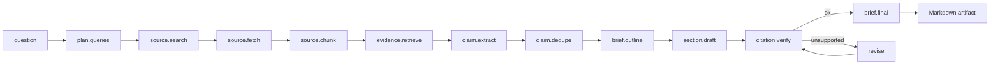
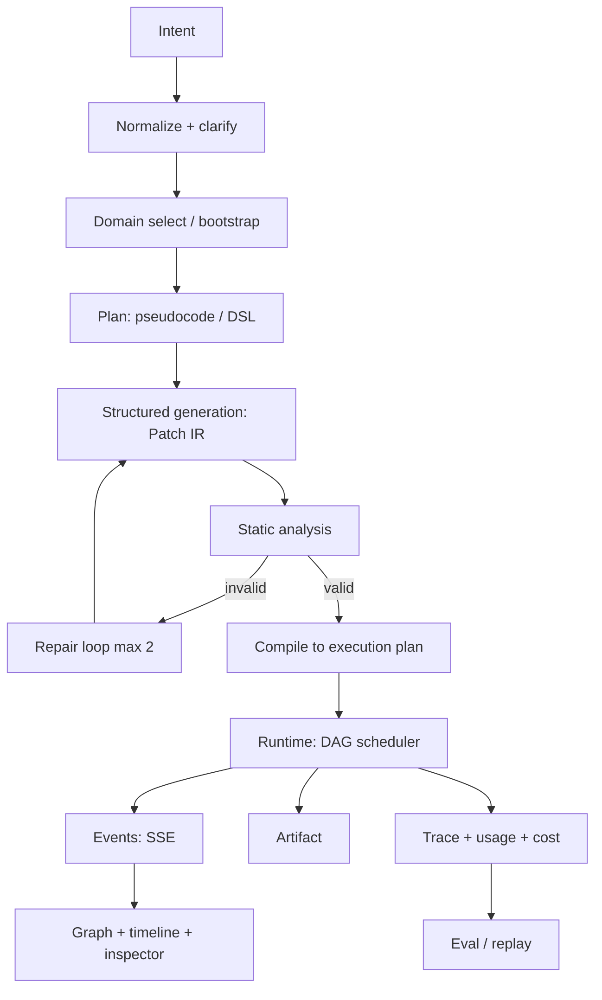

# Glossia v2 — Da POC a sistema dimostrabile

> **Stato (snapshot implementato):** il primo slice verticale è in codice — IR v2, analyzer, repair, runtime DAG con SSE, trace/costi, budget, cache, recipe research con verifica delle citazioni, eval lab, studio, landing e run page. Restano F4–F6 del piano: persistenza su database, share link, graph editing, judge calibrato, prompt A/B, provider extra e hardening. Vedi `README.md` e `docs/REVIEW.md` per il percorso di review.


> **Tesi in una frase**
> Glossia è un **compilatore e runtime per workflow LLM**: trasforma l'intento in un grafo tipizzato, lo esegue davvero e ne dimostra la qualità con trace ed eval.
>
> **LLM propone, il sistema dispone.**

Questo documento è un piano operativo, non una lista di desiderata. Contiene: diagnosi onesta dello stato attuale, posizionamento, caso d'uso hero, architettura, backlog prioritizzato, redesign UI, strategia di eval/sicurezza/costi, roadmap con criteri di uscita, script demo e checklist per i prossimi 7 giorni.

---

## 0. TL;DR — Le 8 decisioni che cambiano il progetto

| # | Decisione | Perché |
|---|-----------|--------|
| 1 | **Posizionamento**: compilatore + runtime + eval, non "graph generator" | Il valore non è il JSON: è ciò che il JSON fa e come lo si dimostra |
| 2 | **Caso hero**: da domanda a *research brief con citazioni verificabili* | RAG + estrazione strutturata + fan-out/fan-in + critic loop + artefatto tangibile |
| 3 | **IR v2 tipizzato**: porte con tipo, non solo nomi | Rende il grafo un vero contratto e abilita errori azionabili |
| 4 | **Runtime vero**: DAG scheduler, streaming SSE, retry, budget, cache, cancel | È il pezzo che oggi manca e che separa un prompt demo da un sistema |
| 5 | **Repair loop + static analyzer deterministico** | Dimostra la maturità che i recruiter cercano: non fidarsi dell'output |
| 6 | **Trace + eval harness con numeri** | "Funziona" diventa una misura, non un'opinione |
| 7 | **Studio redesign**: canvas + inspector + timeline, non 3 colonne di form | L'UI deve raccontare il sistema, non nasconderlo |
| 8 | **Demo mode senza API key + deploy pubblico** | Chi guarda deve poter provare in 30 secondi, non configurare una key |

**Se hai solo 12–15 giornate effettive** (≈3 settimane full-time, 6–7 part-time), fai: F0 + F1 + F2 + hero-lite + studio polish + demo mode. Salta la dashboard eval (tieni lo script e i numeri nel README) e lo share.

---

## 1. Diagnosi

### 1.1 Cosa funziona già (e va conservato)

- **L'idea del domain come type system.** È il pezzo più originale: il modello non inventa liberamente, compone dentro un vocabolario validato. Pochi progetti hanno questo.
- **La pipeline a due fasi** (pseudocode → JSON): intermedio ispezionabile, debug più facile.
- **Zod come contratto unico** per domain e patch: base giusta per structured outputs seri.
- **L'astrazione provider** (OpenAI/OpenRouter) e la separazione prompt/route.
- **L'estetica minimale** e l'attenzione all'accessibilità (tablist, aria-live, focus ring): è una buona base, non va buttata.
- **Il grafo React Flow** è già renderizzato da JSON validato: la base visiva c'è.

### 1.2 Cosa non regge

| Sintomo | Causa | Conseguenza |
|---------|-------|-------------|
| Il prodotto finisce dove inizia la parte interessante | Nessuna esecuzione: i nodi sono "stub semantici" | Sembra un editor di diagrammi, non un sistema LLM |
| Non si capisce il valore in 30 secondi | Hero copy generica, 3 card descrittive, form subito | Chi apre il link non sa cosa guardare |
| Densità e dimensione testo | 3 colonne, 9–10px, toolbar con API key in primo piano | Sembra un IDE del 2010, non un prodotto |
| Narrativa incoerente | Intro con fairy-tale, preset MIDI/immagini/synth | Il visitatore non capisce quale sia il caso d'uso |
| Nessuna persistenza vera | Solo `localStorage`, nessun run salvato | Niente share, niente storia, niente eval |
| Nessuna prova di qualità | Zero test, zero CI, zero eval | "Funziona" è un'opinione |
| Debito strutturale | Hook da 573 righe, componenti da 274, hue casuale per nodo | Difficile estendere e spiegare |
| README promette più del prodotto | "Validation first" ma niente runtime | Gap tra racconto e realtà |

### 1.3 La causa profonda

Glossia oggi è un **generatore di artefatti**, non un **sistema**. Manca il ciclo chiuso:

```
propose → validate → execute → observe → measure → improve
```

Tutto si ferma a `validate`. Il JSON è il prodotto finale, ma il JSON non fa nulla. Per un portfolio, il messaggio che passa è: "so far generare JSON con uno schema". È corretto, ma è il 30% di ciò che serve per dimostrare LLM engineering serio.

**La buona notizia:** l'idea del domain tipizzato è già il nucleo di un compilatore. Basta completare il giro.

---

## 2. Nuova tesi e posizionamento

### 2.1 La frase

> **Glossia compiles intent into a runnable LLM workflow — then proves it works.**
>
> Natural language → typed graph (the IR) → real execution → traces, costs, evals.
> *LLMs propose. The system disposes.*

### 2.2 I tre atti

| Atto | Cosa succede | Cosa dimostra |
|------|--------------|---------------|
| **Compile** | Intento → piano → grafo tipizzato → analisi statica → repair | Structured generation, validazione, correzione |
| **Run** | Il grafo viene eseguito: parallelismo, retry, budget, streaming | Orchestrazione, runtime, gestione del fallimento |
| **Prove** | Trace, costo, replay, eval su golden set | Misura, regressioni, rigore |

Questa struttura è anche la struttura della UI (Design / Run / Evaluate) e della landing (3 sezioni). Un solo racconto, tre livelli.

### 2.3 Perché è difendibile (e non l'ennesimo "AI agent builder")

- **Il grafo è un artefatto ispezionabile**, non un prompt nascosto. Si può versionare, diffare, validare, testare.
- **Il domain è un type system**, non una collezione di tool. Il modello scrive *programmi* in un linguaggio ristretto.
- **La qualità è misurata**, non raccontata. Pochi POC hanno una eval suite e un report.
- **I tradeoff sono espliciti**: DAG vs cicli, structured output nativo vs tool fallback, adapter custom vs framework. Sono le domande che si fanno in un colloquio tecnico.

### 2.4 Le 5 domande a cui il progetto risponde

1. Come tieni sotto controllo l'output di un LLM? → schema + validazione + repair.
2. Come orchestri più chiamate? → DAG tipizzato, parallelismo, budget.
3. Cosa fai quando il modello sbaglia? → error taxonomy, retry, fallback, repair, human-in-the-loop.
4. Come sai che funziona? → eval harness, metriche, regression gate.
5. Come lo rendi usabile? → streaming, trace, diff, demo mode, share.

---

## 3. Il caso hero

### 3.1 Scelta

**"Da una domanda a un research brief con citazioni verificabili."**

Input: una domanda di ricerca + 3–5 fonti (URL, testo incollato, o corpus demo integrato).
Output: un brief Markdown con affermazioni, citazioni `[S1]`, fonti, confidenza, contraddizioni segnalate.

Perché questo caso:

- **Tangibile**: produce un artefatto che si legge, non solo un grafo.
- **Ricco strutturalmente**: fan-out sulle fonti, map sulle sezioni, fan-in, critic loop.
- **Verificabile**: ogni claim deve avere una quote che esiste davvero nella fonte.
- **Economico**: poche migliaia di token per run; nessun servizio esterno obbligatorio se usi un corpus demo.
- **Racconta l'LLM engineering**: retrieval, estrazione strutturata, deduplica, sintesi, verifica.

### 3.2 Alternative (e perché non sono la prima scelta)

| Caso | Pro | Contro | Verdetto |
|------|-----|--------|----------|
| **CSV → report** | Deterministico, utile, grafici | Più data engineering che LLM; meno "wow" | Buon secondo caso |
| **Transcript → decisioni/azioni** | Universale, niente retrieval, verifiche deterministiche (owner, data) | Meno visivo | **Fallback** se il retrieval pesa troppo |
| **Support triage** | Business value, tool calling | Meno memorabile in demo | Terzo caso |
| **Contenuti/marketing** | Facile | Sovraffollato, poco tecnico | No |
| **MIDI/immagini/synth** | Divertente, generalità | Esecuzione povera, nicchia | Tienili come "playground", non hero |

### 3.3 Il grafo hero (versione POC, 12 nodi)



Nel POC i cicli non sono nel grafo: `revise` è un **nodo composito** con loop interno bounded (max 2). Il grafo resta un DAG. È una decisione architetturale importante (vedi §4.3).

### 3.4 L'artefatto e le verifiche

- **Citation checker deterministico**: normalizza testo e quote, verifica che la quote esista nella fonte; se non esiste, il claim viene rimosso o marcato `unsupported`.
- **Contradiction detector**: due claim con stesse entità e polarità opposta → flag.
- **Coverage check**: ogni sezione dell'outline ha almeno una fonte; ogni fonte è citata almeno una volta.
- **Quality badge**: `verified / partially verified / unverified`, con conteggi.

Questa è la parte che fa dire "ok, questo non è l'ennesimo wrapper di ChatGPT".

### 3.5 Demo in 3 minuti (sintesi; script completo in §10)

1. Apri la landing, click **Try the recorded demo** (nessuna key).
2. Scegli la domanda, mostra il budget (Quality / Balanced / Cheap).
3. Il compiler mostra intent, piano, grafo; un badge dice "2 issues fixed automatically".
4. Run: i nodi si accendono, le fonti si parallelizzano, il contatore costo sale.
5. Un nodo fallisce lo schema, retry, poi verde. La timeline mostra attempt 1/2.
6. Appare il brief; click su una citazione → evidenzia la quote nella fonte.
7. Eval tab: 40 casi, 92% pass, p50, costo; confronto prompt v3 vs v4.
8. Chiudi su architettura e README.

---

## 4. Architettura

### 4.1 Pipeline del compilatore



### 4.2 IR v2

Il contratto attuale (`Domain`, `Patch`) va esteso, non riscritto da zero. La migrazione è v1 → v2 con un adapter.

```ts
// lib/ir/types.ts
export type PortType =
  | "text" | "json" | "number" | "boolean"
  | "image" | "audio" | "file" | "any";

export type Port = {
  name: string;
  type: PortType;
  description: string;
  required?: boolean;      // default true per gli input
  multi?: boolean;         // fan-in consentito
};

export type ParamSpec = {
  key: string;
  type: "string" | "number" | "boolean" | "enum";
  description: string;
  required: boolean;
  default?: unknown;
  enum?: string[];
  min?: number;
  max?: number;
  ui?: "text" | "textarea" | "slider" | "select" | "toggle";
};

export type NodeType = {
  id: string;
  name: string;
  description: string;
  category: "input" | "llm" | "tool" | "transform" | "control" | "output";
  inputs: Port[];
  outputs: Port[];
  params: ParamSpec[];
  executor: {
    kind: "llm" | "tool" | "transform" | "control" | "io";
    ref: string;             // chiave nel registry degli executor
    config?: Record<string, unknown>;
  };
};

export type Domain = {
  id: string; version: string;
  name: string; description: string; semantics: string;
  nodeTypes: NodeType[];
};

export type Patch = {
  version: "2";
  domainId: string;
  domainVersion: string;
  nodes: NodeInstance[];
  edges: Edge[];
  meta?: { title?: string; createdBy?: "llm" | "human"; promptVersion?: string };
};

export type NodeInstance = {
  id: string;
  type: string;
  params: Record<string, unknown>;
  position?: { x: number; y: number };
  label?: string;
};

export type Edge = {
  id: string;
  from: string; fromPort: string;
  to: string;   toPort: string;
};
```

**Perché le porte tipizzate.** Oggi un edge può collegare qualsiasi output a qualsiasi input. Con i tipi, l'analizzatore può dire: *"`claim.extract` produce `Claim[]`, `brief.outline` si aspetta `text`; manca un nodo `claims.merge`"*. Questo è il tipo di errore che rende il sistema credibile e la UI utile (l'errore è ancorato al nodo).

**Controlli dell'analizzatore** (deterministici, testabili):

1. Schema Zod del domain e del patch.
2. ID nodo unici.
3. Tipo nodo esistente nel domain e versione compatibile.
4. Param obbligatori presenti.
5. Tipo/enum/range dei param.
6. Endpoint degli edge esistenti.
7. Porte esistenti sul tipo.
8. Compatibilità di tipo tra `fromPort` e `toPort`.
9. Ogni input required ha esattamente un edge entrante (o `multi`).
10. Nessun ciclo (v2).
11. Ogni nodo è raggiungibile da un input e raggiunge un output.
12. Nessun nodo morto / output non consumato (warning).
13. Limiti: max 40 nodi, 80 edge, 20k token stimati.
14. Costo stimato vs budget.
15. URL allowlist per nodi `fetch`.
16. Nessun param sconosciuto (o warning).
17. Nessun edge duplicato.
18. Label/ID validi (kebab/snake, niente collisioni).
19. Il domain dichiara almeno un input e un output.
20. Il patch non referenzia un domain diverso da quello attivo.
21. `meta.promptVersion` presente se generato da LLM.
22. Coerenza delle unità/scale per i param numerici (dove dichiarato).
23. Nessun nodo `tool` con side effect non dichiarato.
24. Nessun segreto nei param.
25. Dimensione testuale entro i limiti.
26. Il grafo è serializzabile e round-trippabile.

**Errori azionabili**, non muri di testo:

```ts
type GraphIssue = {
  code: string;                 // "PORT_TYPE_MISMATCH"
  severity: "error" | "warning";
  message: string;              // umano
  nodeId?: string;
  edgeId?: string;
  fix?: { kind: "setParam" | "addNode" | "rewire" | "removeNode"; payload?: unknown };
};
```

La UI mostra l'issue sul nodo/edge, con un bottone "Fix" quando il fix è deterministico. Questo è un enorme salto di qualità rispetto alla lista di stringhe attuale.

### 4.3 Runtime

**Semantica di esecuzione.**

- Un nodo è *runnable* quando tutti gli input required hanno un valore (da edge o default).
- I valori vivono in una mappa `(nodeId, portName) → value`.
- La schedulazione è topologica, con concorrenza configurabile (default 4).
- Fan-out: lo stesso output può alimentare più nodi (il valore è immutabile).
- Fan-in: consentito solo su porte `multi`, che ricevono un array ordinato.
- **Niente cicli arbitrari nel grafo.** I loop (critic, revise, retry semantico) vivono dentro **nodi compositi** con un limite interno. Motivo: il DAG scheduler resta semplice, deterministico e debuggabile; i loop restano comunque visibili nella trace come sub-span.
- Cancellazione: `AbortController` propagato a fetch e chiamate LLM; stato `cancelled` con step parziali.
- Budget: controllato prima di ogni chiamata; a esaurimento il run si ferma con `BUDGET_EXCEEDED` e artefatto parziale.
- Cache: chiave content-addressed; hit → evento `step.cached`, costo 0, latenza ~0.
- Persistenza: ogni step è un record immutabile; il run è ricostruibile.

```ts
// lib/runtime/events.ts
export type RunEvent =
  | { seq: number; type: "run.started"; runId: string; at: string }
  | { seq: number; type: "step.started"; nodeId: string; attempt: number }
  | { seq: number; type: "step.delta"; nodeId: string; text: string }
  | { seq: number; type: "step.completed"; nodeId: string; output: unknown; usage: Usage; ms: number }
  | { seq: number; type: "step.failed"; nodeId: string; error: AppError; retryable: boolean }
  | { seq: number; type: "step.cached"; nodeId: string; savedUsd: number }
  | { seq: number; type: "run.completed"; artifact?: Artifact; usage: Usage; costUsd: number }
  | { seq: number; type: "run.failed"; error: AppError }
  | { seq: number; type: "run.cancelled" };
```

SSE con `id: seq`; il client può riprendere con `Last-Event-ID`. I delta sono opzionali (solo nodi LLM con `stream: true`).

**Retry policy.**

| Errore | Retry | Note |
|--------|-------|------|
| `SCHEMA_INVALID` | repair loop (max 2) | prompt di riparazione con errori compatti |
| `PROVIDER_RATE_LIMIT` | backoff esponenziale + jitter (max 3) | rispetta `Retry-After` |
| `PROVIDER_TIMEOUT` | 1 retry | timeout per nodo |
| `PROVIDER_AUTH` | no | messaggio azionabile |
| `TOOL_ERROR` | 1 retry se idempotente | altrimenti fail |
| `BUDGET_EXCEEDED` | no | stop pulito |
| `CANCELLED` | no | stop immediato |

**Budget.**

```ts
type Budget = {
  maxUsd: number;
  maxTokens: number;
  maxWallMs: number;
  maxSteps: number;
};
```

Default demo: `$0.25`, `60k token`, `120s`, `30 step`. La UI mostra una barra; a 70% ambra, a 90% rossa. A 100% il run si mette in pausa e chiede "alza budget o ferma".

### 4.4 LLM layer

**Adapter unico, provider dietro.**

```ts
export interface LlmAdapter {
  id: string;
  capabilities: {
    jsonSchema: boolean;
    tools: boolean;
    streaming: boolean;
    vision: boolean;
    seed: boolean;
  };
  generate(req: LlmRequest, signal?: AbortSignal): Promise<LlmResponse>;
}
```

Implementazioni POC: `openai-compatible` (copre OpenAI, OpenRouter, Ollama, vLLM) + `anthropic`. Il resto è futuro.

**Structured output a 3 livelli.**

1. **Native JSON Schema** (`response_format: { type: "json_schema" }`) se il modello lo supporta.
2. **Tool calling forzato** (`tool_choice` su un tool con schema) come fallback.
3. **Prompt + parser + repair** come ultima spiaggia.

Lo schema si genera da Zod con `z.toJSONSchema()` (Zod 4). Il prompt non deve contenere tutto lo schema se il decoding è vincolato: meno token, meno errori.

**Repair loop.**

```ts
for (let attempt = 0; attempt <= 2; attempt++) {
  const raw = await generate(schema);
  const parsed = safeParse(raw);
  if (parsed.ok && analyze(parsed.data).ok) return parsed.data;

  const issues = parsed.ok ? analyze(parsed.data).issues : parsed.issues;
  if (attempt === 0) raw = deterministicAutofix(raw, issues); // fence, virgole, numeri, param sconosciuti
  prompt = repairPrompt({ raw, issues, schemaExcerpt, attempt });
}
return bestAttemptWithIssues();
```

Il repair prompt deve contenere: output originale, lista errori con path, estratto di schema/domain, istruzione "output only JSON, non spiegare". Max 2 tentativi per non bruciare budget.

**Model routing.**

| Ruolo | Modello | Perché |
|-------|---------|--------|
| Planner / compiler | modello forte (es. `gpt-4.1`, `claude-sonnet`) | qualità del grafo |
| Worker (extract, draft) | mini (es. `gpt-4.1-mini`) | costo/latenza |
| Judge / critic | mid | equilibrio |
| Fallback | catena configurabile | resilienza |

Il routing è dichiarativo in `models.ts`, non hardcoded nelle route. La trace salva modello, prompt version, temperatura, seed.

**Prompt registry.**

```
prompts/
  compose.system.md
  compose.repair.md
  domain.bootstrap.md
  critic.graph.md
  judge.rubric.md
  manifest.json
```

Ogni prompt ha `id`, `version`, `hash`. L'hash finisce nella trace e nei risultati eval. Niente prompt inline nelle route.

**Custom adapter vs Vercel AI SDK.** L'AI SDK accelera streaming e tool loop, ma l'orchestrazione è *il* cosa che vuoi dimostrare. Consiglio: adapter sottile custom per il runtime; se vuoi, usa l'AI SDK solo in uno spike per confrontare. Nel README spiega la scelta.

### 4.5 Trace e eval

**Span model.**

```ts
type Span = {
  id: string;
  runId: string;
  stepId?: string;
  name: string;                 // "llm.compose", "tool.fetch", "validate"
  kind: "llm" | "tool" | "validate" | "repair" | "run";
  start: string; end?: string;
  status: "ok" | "error" | "cancelled";
  attributes: Record<string, unknown>;
  events?: { at: string; name: string; data?: unknown }[];
};
```

La UI timeline è un waterfall: barre orizzontali, lane per parallelismo, critical path evidenziato, click → inspector.

**Eval.** Vedi §8. La trace è la fonte dati: ogni metrica deriva da run registrati, non da log sparsi.

### 4.6 Persistenza

| Opzione | Pro | Contro | Scelta |
|---------|-----|--------|--------|
| `localStorage` | zero setup | no share, no eval, no storia | solo preferenze UI |
| SQLite + Drizzle | locale, semplice, deploy su Fly/Render | non Vercel serverless | **POC self-host** |
| Postgres (Neon) + Drizzle | Vercel-ready, share, eval | un servizio in più | **deploy portfolio** |

Consiglio: **repository interface** + Drizzle; in locale SQLite, in produzione Neon. Se non vuoi un DB, minimum viable: run serializzati in JSON su filesystem + URL compresso per lo share. Ma per eval e trace la persistenza serve.

Tabelle minime: `domains`, `patches`, `runs`, `steps`, `spans`, `artifacts`, `eval_suites`, `eval_cases`, `eval_runs`, `eval_results`, `prompt_versions`, `models`.

### 4.7 Mappa file (target)

```text
lib/
  ir/
    types.ts            # PortType, Domain, Patch, Run
    schema.ts           # Zod + toJSONSchema
    analyze.ts          # 26 checks, GraphIssue
    layout.ts           # dagre/elk auto-layout
    diff.ts             # patch diff semantico
    migrate.ts          # v1 -> v2
  llm/
    adapter.ts          # interfaccia + capabilities
    openai.ts           # OpenAI/OpenRouter/Ollama
    anthropic.ts
    structured.ts       # json_schema / tool / prompt
    repair.ts
    registry.ts         # modelli, prezzi, capability
    router.ts
    prompts.ts          # loader + hash
  runtime/
    executor.ts         # orchestrazione run
    scheduler.ts        # DAG, concorrenza
    events.ts           # SSE types
    budget.ts
    cache.ts
    store.ts            # persistenza run
    nodes/              # executor per tipo
  eval/
    dataset.ts
    runner.ts
    metrics.ts
    judge.ts
    report.ts
  trace/
    span.ts
    recorder.ts
app/
  (marketing)/page.tsx
  studio/page.tsx
  studio/components/...
  runs/[id]/page.tsx
  api/
    compile/route.ts
    runs/route.ts
    runs/[id]/stream/route.ts
    runs/[id]/cancel/route.ts
    eval/route.ts
    models/route.ts
prompts/
evals/
  cases/*.yaml
  fixtures/
docs/
  adr/
```

**Strategia di migrazione.** Non riscrivere tutto in un colpo. Tieni la vecchia `app/home` come `legacy` dietro flag, costruisci `lib/ir`, `lib/runtime`, `app/studio` in parallelo, switcha quando il nuovo hero funziona, poi cancella il vecchio. Così la demo resta sempre verde.

### 4.8 Decision log (da mettere in `docs/adr/`)

| ID | Decisione | Alternativa scartata | Motivo |
|----|-----------|----------------------|--------|
| D1 | Compiler + runtime + eval | Agent builder generico | Più difendibile, misurabile, originale |
| D2 | DAG + nodi compositi per i loop | Cicli arbitrari nel grafo | Scheduler semplice, deterministico, debug |
| D3 | Adapter custom sottile | Vercel AI SDK per tutto | L'orchestrazione è il valore da mostrare |
| D4 | SQLite/Postgres + Drizzle | Solo localStorage | Trace, eval, share |
| D5 | Un hero verticale | 4 preset generici | Un POC si giudica dalla profondità, non dalla breadth |
| D6 | Eval harness + judge | Test manuali | "Funziona" deve essere un numero |
| D7 | Demo mode registrata | Key obbligatoria | Il link portfolio deve funzionare sempre |

---

## 5. Backlog prioritizzato

Legenda: **P0** = senza questo il POC non è credibile; **P1** = il "wow"; **P2** = post-POC. Sforzo: S ≤ 1 giorno, M 2–4, L 5–8, XL > 8.

### 5.1 LLM core

| # | Feature | Perché | P | Sforzo |
|---|---------|--------|---|--------|
| 1 | Native structured outputs + JSON Schema | Elimina la maggior parte degli errori di parsing | P0 | M |
| 2 | Repair loop con errori azionabili | Dimostra robustezza, è un momento demo | P0 | M |
| 3 | Streaming token + eventi di run | Percepisce il sistema "vivo" | P0 | M |
| 4 | Tool calling / nodi tool | RAG, fetch, search | P0 | M |
| 5 | Model router + fallback | Costo/qualità, resilienza | P1 | M |
| 6 | Prompt registry + versioning | Reproducibilità, A/B | P1 | M |
| 7 | Cache esatta + semantica | Re-run economici, demo incrementale | P1 | M |
| 8 | Critic / verifier | Qualità semantica, non solo schema | P0 | M |
| 9 | RAG con citazioni | Hero case | P0 | L |
| 10 | Guardrail prompt injection | Rischio reale nei workflow con fonti | P1 | M |
| 11 | Clarifying question | Mostra human-in-the-loop | P1 | M |
| 12 | Best-of-N su nodi critici | Qualità vs costo | P2 | M |

### 5.2 Runtime

| # | Feature | Perché | P | Sforzo |
|---|---------|--------|---|--------|
| 13 | DAG scheduler + parallelismo | Cuore del runtime | P0 | L |
| 14 | Porte tipizzate + fan-in | Contratto vero | P0 | M |
| 15 | Retry/timeout/backoff/cancel | Affidabilità | P0 | M |
| 16 | Budget guard | Evita costi fuori controllo | P0 | S |
| 17 | Persistenza run + resume | Trace, share, eval | P0 | M |
| 18 | Cache + re-run incrementale | Demo "cambia un nodo, ricalcola solo quello" | P1 | M |
| 19 | Replay + cassette | Test deterministici, demo offline | P1 | M |
| 20 | Human approval gate | Per azioni con side effect | P1 | M |
| 21 | Trigger schedulati/webhook | Automazione | P2 | L |

### 5.3 Trust

| # | Feature | Perché | P | Sforzo |
|---|---------|--------|---|--------|
| 22 | Static analyzer 26 check | Errori precisi, UI annotata | P0 | M |
| 23 | Graph diff + accept/reject | Rendere visibile il repair | P0 | M |
| 24 | Trace waterfall + prompt inspector | Debug e storytelling | P0 | M |
| 25 | Cost/token accounting | Rispetto del budget, numeri | P0 | S |
| 26 | Eval harness + golden set | Prova di qualità | P0 | L |
| 27 | LLM-as-judge con rubrica | Valuta semantica | P1 | M |
| 28 | Calibrazione judge vs umano | Rigore, kappa | P1 | M |
| 29 | Regression dashboard + CI | Il progetto "sa" se peggiora | P1 | M |
| 30 | Chaos mode | Demo della resilienza | P1 | S |
| 31 | Share report | Portfolio, review | P2 | S |

### 5.4 Product/UX

| # | Feature | Perché | P | Sforzo |
|---|---------|--------|---|--------|
| 32 | Landing con demo live | Primo impatto | P0 | M |
| 33 | Studio canvas + inspector + timeline | Il prodotto | P0 | L |
| 34 | Grafo editabile | Da viewer a strumento | P1 | L |
| 35 | Demo mode senza key | Chiunque può provare | P0 | M |
| 36 | Export JSON/Mermaid/PNG/artefatto | Utilità e share | P1 | S |
| 37 | Command palette + shortcut | Percezione di prodotto | P2 | S |
| 38 | Onboarding/template gallery | Riduce il tempo al primo wow | P1 | M |
| 39 | Responsive + a11y | Qualità | P1 | M |
| 40 | Motion/visual identity | Wow | P1 | M |

### 5.5 Engineering

| # | Feature | Perché | P | Sforzo |
|---|---------|--------|---|--------|
| 41 | Adapter OpenAI + Anthropic | Provider abstraction vera | P1 | M |
| 42 | Env tipizzato + error taxonomy | Debug, messaggi | P0 | S |
| 43 | Unit/contract/integration/e2e | Qualità | P0 | L |
| 44 | CI + preview deploy | Professionalità | P0 | S |
| 45 | Logging strutturato + requestId | Operabilità | P1 | S |
| 46 | Rate limit + body limit | Sicurezza | P1 | S |
| 47 | Persistenza Drizzle | Storia/share/eval | P0 | M |
| 48 | Docs/ADR/case study | Racconto | P0 | M |

---

## 6. UI/UX redesign

### 6.1 Cosa non funziona oggi

- La prima schermata è **tre colonne di form** con testo a 9–10px; il grafo è confinato a destra e sembra un output secondario.
- L'**API key** sta nella toolbar, in alto: il primo messaggio è "configura", non "guarda cosa sa fare".
- Il grafo ha **colori casuali per tipo** (hash hue): rumore, non informazione.
- La **narrativa** è fairy-tale nell'intro e MIDI nei preset: due prodotti diversi.
- Non c'è **stato di esecuzione**, quindi il grafo è statico e muto.
- Il contrasto tra hero editoriale e workspace microscopico è stridente.

### 6.2 Direzione visiva

**"Technical console"**: un strumento operativo, non una pagina editoriale. Riferimento: dashboard di automazione industriale, pannelli bianchi, dati densi, un solo accento freddo.

- **Tipografia**: Geist per la UI, Geist Mono per dati e label. Niente serif, niente display editoriale. Scala 11–13px per i dati, 14–16px per i titoli di pannello, 30–40px solo per l'hero.
- **Palette**: grigi freddi (`#f4f5f7` / `#ffffff`), inchiostro `#0c0f14`, **accento blu tecnico** `#2f5bff`, verde `#0b8a5c` per gli stati ok, ambra e rosso per warning/error. Un colore categoriale per tipo di nodo, non hue casuali.
- **Superfici**: 8px radius, bordi 1px, ombre quasi assenti. Niente grain, niente gradienti decorativi.
- **Layout**: studio full-bleed a tre pannelli (rail operativo, canvas, inspector); landing max 1240 con griglia tecnica e un preview del console.
- **Motion**: 150–250ms; il movimento comunica stato (nodo attivo, edge che porta dati), non decora.

### 6.3 Struttura della landing

1. **Hero**: headline sans compatta + preview del console a destra (run, metriche, pipeline, trace). CTA: *Open console* / *Run the recorded demo*.
2. **Proof strip**: numeri veri dall'eval (validità, pass rate, p50, costo/run).
3. **"Not a chatbot"**: 3 frame — Intent → IR → Run.
4. **"What breaks"**: JSON malformato riparato, nodo in retry, budget stop. È la sezione che differenzia.
5. **Architettura**: diagramma + 4 scelte chiave.
6. **Eval**: tabella con 40 casi e delta tra prompt version.
7. **CTA finale** + GitHub + video 90s.

Copy proposta:

> **Compile, run, and verify LLM workflows.**
> A typed IR for LLM workflows: schema-validated graphs, real execution, traces and evals. Not a chat UI — the runtime after the prompt.

### 6.4 Studio layout

```text
┌──────────────────────────────────────────────────────────────────────┐
│ glossia   research-brief ▾   gpt-4.1-mini ▾   $0.04 / $0.25   ▶ Run │
├──────────────┬───────────────────────────────────────┬───────────────┤
│ RECIPES      │                                       │ INSPECTOR     │
│ · Research   │            GRAPH CANVAS               │ Configure     │
│ · Transcript │     (nodes, ports, live status)       │ Run           │
│ · CSV report │                                       │ Trace         │
│              │                                       │               │
│ NODE LIBRARY │                                       │ prompt/model  │
│ · input      │                                       │ params        │
│ · llm        │                                       │ output        │
│ · tool       │                                       │ attempts      │
├──────────────┴───────────────────────────────────────┴───────────────┤
│ TIMELINE  compile ██  retrieve ████  extract ██████  draft ████████   │
└──────────────────────────────────────────────────────────────────────┘
```

- **Top bar**: ricetta, modello, budget meter, Run/Stop, stato.
- **Left rail**: ricette + libreria nodi (drag → canvas, P1).
- **Canvas**: nodi con categoria, icone, porte etichettate, status ring, preview output, badge token/costo. Edge animati solo durante il run. Minimap, zoom, auto-layout.
- **Inspector**: tab Configure / Run / Trace. Mostra prompt, modello, input, output, errori, tentativi, costo.
- **Timeline**: waterfall, lane per parallelismo, click → focus nodo. Collassabile.
- **Settings modal**: API key, provider, tema, demo mode. Non in toolbar.
- **Run page** `/runs/[id]`: read-only share con grafo, artefatto, trace, badge verified.

### 6.5 Graph design

- Nodo minimo 220×110; testo 12–13px, non 9.
- Header con icona categoria + nome tipo; body con ID e 2–3 param chiave; footer con stato e costo.
- Porte: pallini colorati per tipo, label on hover; input a sinistra, output a destra.
- Stati: `idle` (bordo neutro), `queued` (tratteggio), `running` (ring pulsante), `ok` (check), `error` (rosso + retry count), `cached` (fulmine).
- Edge: grigio neutro; durante il run, un dot animato nella direzione del flusso; critical path evidenziato; branch inattivi dimmati.
- Errori: badge sul nodo, click → inspector con messaggio e fix.
- Layout: dagre/elk, left-to-right; posizioni salvate se l'utente sposta.

### 6.6 Motion e accessibilità

- Rispetta `prefers-reduced-motion` (già presente in `globals.css`).
- `aria-live="polite"` per gli eventi di run (chi esegue, chi completa, errori).
- Focus visibile su canvas e inspector; scorciatoie documentate.
- Contrasto ≥ 4.5:1 per il testo; non affidare il colore da solo allo stato (icona + label).
- Tastiera: `Cmd/Ctrl+Enter` run, `Cmd/Ctrl+K` palette, `Esc` chiude inspector, frecce per navigare i nodi.

---

## 7. Affidabilità, sicurezza, costi

### 7.1 Error taxonomy

```ts
type ErrorCode =
  | "CONFIG" | "PROVIDER_AUTH" | "PROVIDER_RATE_LIMIT" | "PROVIDER_TIMEOUT"
  | "SCHEMA_INVALID" | "DOMAIN_INVALID" | "GRAPH_INVALID" | "PORT_TYPE_MISMATCH"
  | "BUDGET_EXCEEDED" | "CANCELLED" | "TOOL_ERROR" | "UNSUPPORTED" | "INTERNAL";
```

Ogni errore ha: codice, messaggio umano, `retryable`, `hint`, `docsUrl?`. La UI non mostra mai uno stack trace.

### 7.2 Sicurezza

| Rischio | Mitigazione |
|---------|-------------|
| API key nel browser | BYOK in `sessionStorage` (non `localStorage`), mai loggata, mai nel server store; oppure env server |
| Prompt injection da fonti | contenuti in tag `<untrusted>`, istruzione di gerarchia, tool allowlist, niente side effect senza approvazione |
| SSRF nel fetch | solo https, blocco IP privati/loopback/link-local, DNS re-check, redirect limitati, timeout, max 2MB |
| Cost runaway | budget per run, max token, max step, rate limit per IP |
| XSS nell'artefatto | sanitize Markdown, niente HTML raw |
| Abuso API | rate limit, body limit, captcha solo se serve |
| Dati sensibili | redazione nei log, retention breve, nessun contenuto in chiaro nei fixture pubblici |

**Nota concreta:** oggi la key è in `localStorage` (`useGlossiaStudio.ts`). È un rischio XSS e un cattivo segnale. Spostala in `sessionStorage` + settings, e documenta il tradeoff. Meglio ancora: server-side session con key cifrata, ma per un POC BYOK è accettabile se dichiarato.

### 7.3 Costi

| Voce | Stima |
|------|-------|
| Compile (planner + repair) | $0.002–0.01 |
| Run hero (12 nodi, mini) | $0.02–0.08 |
| Eval 40 casi | $1–3 |
| Demo mode | $0 |

Regole: planner su modello forte, worker su mini; cache; max 2 repair; budget default $0.25; niente retry infiniti. Nel README mostra il costo medio per run: è un segnale di maturità.

---

## 8. Eval e osservabilità

### 8.1 Dataset

`evals/cases/*.yaml`, 40 casi:

- 10 facili (catena lineare)
- 10 medi (branch/merge)
- 10 difficili (vincoli, ambiguità, richieste impossibili)
- 5 adversarial (prompt injection, contraddizioni, param fuori range)
- 5 regression (bug storici)

Campi: `id`, `domain`, `intent`, `constraints`, `expected` (tipi di nodo, param obbligatori, forbidden), `rubric`, `artifactChecks`.

### 8.2 Metriche

| Metrica | Formula / definizione | Target POC |
|---------|----------------------|------------|
| `validity@1` | patch validi al primo colpo / totale | ≥ 85% |
| `validity@repair` | validi dopo repair / totale | ≥ 98% |
| `nodeRecall` | tipi attesi presenti / attesi | ≥ 0.85 |
| `nodePrecision` | tipi corretti / generati | ≥ 0.80 |
| `edgeF1` | F1 sul multiset `(fromType, toType)` | ≥ 0.75 |
| `paramAccuracy` | param chiave corretti / attesi | ≥ 0.85 |
| `semanticScore` | media rubric 1–5 del judge | ≥ 4.0 |
| `repairRate` | run che richiedono repair | monitor |
| `p50/p95 latency` | compile e run | p50 < 8s / < 60s |
| `costPerValidGraph` | costo totale / grafi validi | < $0.10 |
| `citationSupport` | claim con quote verificata / claim | ≥ 95% |

`edgeF1` è una semplificazione: confronta la "forma" del grafo per tipi, non l'allineamento esatto delle istanze. Documentalo. Per i casi con ID attesi, usa anche l'allineamento esatto.

### 8.3 Judge

Rubrica 1–5 su 5 dimensioni: copertura dell'intento, correttezza del flusso, param, minimalità, conformità al domain. Output strutturato con `score`, `rationale`, `evidence`.

- **Pairwise A/B** tra prompt version, con swap di posizione per il position bias.
- **Calibrazione**: 20 esempi etichettati a mano; riporta accordo (Cohen's kappa) e correlation.
- **Judge diverso dal worker**: non usare lo stesso modello per generare e giudicare, se possibile.

### 8.4 CI e dashboard

- `pnpm eval --suite smoke` in CI con cassette registrate (nessuna key, deterministico).
- Nightly con API reali; report salvato e commentato sulla PR.
- Gate: blocco se `validity@repair` scende > 2% o `semanticScore` > 0.3.
- Dashboard `/eval`: tabella suite, run, delta, sparkline, drill-down sui fallimenti, export CSV/Markdown.

### 8.5 Osservabilità

- Ogni run ha `runId`, `requestId`, `promptVersion`, `model`, `seed`.
- Log strutturati (pino) con redazione delle key.
- Trace esportabile JSON; opzionale export OTLP.
- Errori raggruppati per codice e nodo.
- "Why this run cost $0.06": breakdown per step.

---

## 9. Roadmap

### 9.1 Sequenza (importante)

**Runtime prima della UI.** Costruisci il motore con un **fake LLM deterministico** (risposte fixture), così sviluppi scheduler, eventi, trace e test senza spendere e senza flaky. Solo dopo colleghi il provider reale. Chi parte dalla UI finisce con una bella scatola vuota.

### 9.2 Fasi

Le durate sono **giornate di lavoro effettive** (6–8 h), non giorni di calendario.

| Fase | Durata (gg effettivi) | Obiettivo | Deliverable | Exit criteria |
|------|--------------------|-----------|-------------|---------------|
| **F0 — Fondamenta** | 2–3 gg | Igiene e direzione | Tag `legacy`, un solo lockfile, `public/public` rimosso, env tipizzato, error taxonomy, Vitest, CI, README v2 skeleton | `lint + typecheck + test + build` verdi |
| **F1 — Compiler v2** | 6–8 gg | IR tipizzato e repair | `lib/ir/*`, analyzer 26 check, structured output, repair, diff, test | 20/20 prompt adversarial → grafo valido o errore azionabile; repair visibile |
| **F2 — Runtime v1** | 7–10 gg | Esecuzione vera | scheduler, 8–10 executor, SSE, trace, budget, cancel, cache | Hero recipe eseguita end-to-end; cancel < 500ms; re-run cached < 2s |
| **F3 — Hero vertical** | 5–7 gg | Research brief | nodi RAG, citation checker, artifact viewer, fonti demo | 3/3 domande → brief con citazioni; 0 claim non supportati non marcati |
| **F4 — Trust** | 5–7 gg | Eval e regressioni | 40 casi, metriche, judge, dashboard, CI nightly | Report con numeri; una regressione viene intercettata |
| **F5 — Experience** | 5–7 gg | Wow | landing, studio redesign, visual identity, motion, onboarding, demo mode | Demo 3 minuti senza toccare codice; nessuna key in demo |
| **F6 — Packaging** | 2–3 gg | Portfolio | README case study, video 90s, ADR, deploy, reviewer guide | Un reviewer esterno capisce in 5 minuti |

**Totale: 32–45 giornate effettive.**
- Full-time (5 gg/settimana): **7–9 settimane**.
- Part-time (15–20 h/settimana): **3–4 mesi**.

### 9.3 Track "minimum wow" (12–15 giornate)

F0 + F1 + F2 + hero-lite (senza citation checker completo) + studio polish + demo mode. Eval: solo script + numeri nel README. Share e dashboard: no.

### 9.4 Cosa NON fare in parallelo

- Non aggiungere altri domain preset prima che il runtime funzioni.
- Non costruire auth, team, billing, marketplace.
- Non fare 5 provider: due bastano.
- Non fare un editor di codice completo (Monaco): un textarea con highlight leggero basta.
- Non ottimizzare il bundle prima di avere la demo.

---

## 10. Demo script (3 minuti)

**Setup**: demo mode, fonti pre-registrate, budget $0.25, modello mini, browser pulito, font size generosa.

| Tempo | Azione | Cosa dici | Cosa dimostra |
|-------|--------|-----------|---------------|
| 0:00 | Landing | "Glossia compila intento in workflow eseguibili e li prova." | Positioning |
| 0:15 | Click *Try demo* | "Nessuna key: questa è una run registrata." | Accessibilità |
| 0:25 | Scegli domanda + "Balanced" | "Il budget è un vincolo di prima classe." | Cost control |
| 0:35 | Compile | "Il modello propone; l'analizzatore dispone." | Separation of concerns |
| 0:50 | Badge "2 issues fixed" | "Un nodo inventato, una porta sbagliata. Repair automatico." | Robustezza |
| 1:00 | Run | "Le fonti si parallelizzano; il resto è un DAG." | Orchestrazione |
| 1:20 | Nodo fallisce, retry | "Schema error → repair, non crash." | Failure handling |
| 1:35 | Brief + click citazione | "Ogni claim è verificato contro la fonte." | Trust |
| 1:55 | Inspector trace | "Prompt, modello, token, costo, tentativi." | Observability |
| 2:15 | Eval | "40 casi, 92% pass, p50 38s, $0.04/run." | Misura |
| 2:35 | Confronto prompt v3/v4 | "Le regressioni si vedono prima del deploy." | Rigore |
| 2:50 | Architettura/README | "Tre atti: compila, esegui, dimostra." | Sintesi |

**Piano B**: se la rete/API fallisce, la demo mode è già registrata. Tieni un video di backup e un run salvato.

---

## 11. Packaging portfolio

### 11.1 README come case study

Ordine: problema → tesi → demo GIF → come funziona (3 atti) → architettura → numeri eval → tradeoff → cosa non fa → come provarlo → autore. Niente feature list infinite.

### 11.2 Asset

- **Video 90s** con caption, caricato su YouTube/Loom e linkato.
- **GIF** nel README: compile + run + trace (8–10s).
- **3 screenshot**: landing, studio in run, eval dashboard.
- **Diagramma architettura** (Mermaid nel README, Excalidraw per il video).
- **Reviewer guide** `docs/REVIEW.md`: percorso in 5 minuti, file chiave, domande a cui il progetto risponde.

### 11.3 Docs

- `docs/architecture.md`
- `docs/adr/0001-...md` … `0007-...md`
- `docs/evals.md` con tabella e metodologia
- `docs/prompting.md` con le versioni e cosa è cambiato
- `docs/demo-script.md`
- `docs/case-study.md` con fallimenti e lezioni

### 11.4 Deploy

- Vercel per landing/studio + Neon per Postgres, oppure Fly/Render + SQLite.
- `DEMO_MODE=1` di default sul deploy portfolio: nessuna key, cassette registrate.
- `REAL_MODE=1` con BYOK per chi vuole provare davvero.
- Rate limit e budget anche in demo mode (per evitare abusi).
- OG image per `/runs/[id]` e per la landing.

### 11.5 Igiene repo

- Un solo lockfile (`pnpm` o `npm`, non entrambi).
- Rimuovere `public/public/`, `ProjectAboutSection` se non usato, `docs/PIANO-POC.md` archiviato.
- `.env.example` con tutte le variabili.
- `LICENSE`, `CONTRIBUTING` non necessari per un POC, ma `LICENSE` sì.
- Metadata Next aggiornati (title/description/OG).

---

## 12. Rischi, anti-goal, cut list

### 12.1 Rischi

| Rischio | Prob. | Impatto | Mitigazione |
|---------|-------|---------|-------------|
| Scope creep | Alta | Alto | Fasi con exit criteria; cut list; un hero |
| Latenza percepita | Media | Alto | Streaming, parallelismo, cache, demo mode |
| Nondeterminismo | Alta | Medio | temperature 0, seed, repair, cassette |
| Costi API | Media | Medio | Budget, mini per worker, cache, eval piccole |
| Provider down/rate limit | Media | Alto | Fallback, retry, demo registrata |
| UI troppo complessa | Media | Medio | 3 pannelli, 3 tab, progressive disclosure |
| Judge bias | Media | Medio | Rubrica, pairwise, calibrazione umana |
| Next 16 API diverse | Media | Medio | Leggere `node_modules/next/dist/docs/` prima di scrivere route/streaming |
| Tempo | Alta | Alto | Minimum wow track; taglio P2 |

### 12.2 Anti-goal (dichiarali nel README)

- Auth, team, ruoli, billing.
- Marketplace di workflow.
- Esecuzione di codice arbitrario.
- 10 provider.
- Fine-tuning.
- App mobile.
- Microservizi/Kubernetes.
- Realtime collaboration.

### 12.3 Cut list (in ordine di taglio)

1. Share report (P2).
2. Command palette (P2).
3. Grafo editabile completo (P1 → solo param edit).
4. Human approval gate (P1).
5. Replay esatto (P1 → solo cache).
6. Secondo provider (P1 → solo OpenAI-compatible).
7. Dashboard eval (P1 → solo report Markdown).
8. Citation checker avanzato (P0 → solo quote match).

---

## 13. Definition of Done

- [ ] Un estraneo apre il link, click **Try demo**, vede compile + run + artefatto + trace in < 90s, senza key.
- [ ] Un reviewer clona, `pnpm i && pnpm dev`, inserisce la sua key e ripete il flusso.
- [ ] Tutti i grafi renderizzati passano schema + domain + porte.
- [ ] Repair loop dimostrabile con un pulsante "chaos".
- [ ] Run cancellabile; budget rispettato; cache hit visibile.
- [ ] Trace completa: prompt, modello, token, costo, tentativi.
- [ ] Eval suite con 40 casi e report con numeri; regression gate in CI.
- [ ] Landing + studio + run page con design coerente.
- [ ] Test core verdi, CI verde, build verde.
- [ ] README case study + video 90s + 3 screenshot + ADR.
- [ ] Nessuna key in `localStorage`; nessun segreto nei log.
- [ ] Demo script provato 3 volte, con piano B.

---

## 14. Prossimi 7 giorni

**Giorno 1 — Direzione**
- Tagga lo stato attuale (`git tag legacy-poc`).
- Scrivi un one-pager: tesi, hero, 3 metriche, anti-goal.
- Scegli persistenza e deploy (consiglio: Drizzle + Neon per il portfolio).
- Leggi i doc di Next 16 per route handler/streaming.

**Giorno 2 — Fondamenta**
- Un solo lockfile; rimuovi `public/public`; `.env.example`; error taxonomy.
- Installa Vitest + Playwright + MSW; primo test su `validatePatch`.
- CI: lint, typecheck, test, build.

**Giorno 3 — IR v2**
- `lib/ir/types.ts` + `schema.ts` con porte tipizzate.
- Migra i 4 preset a v2 (o solo MIDI + research).
- Test: schema, port mismatch, ciclo, input mancante.

**Giorno 4 — Analyzer + repair**
- 26 check con `GraphIssue` e fix deterministici.
- Structured output con JSON Schema (o tool fallback).
- Repair loop con 2 tentativi; test con output malformati fixture.

**Giorno 5 — Runtime skeleton**
- Scheduler DAG con concorrenza; eventi SSE; fake LLM.
- 5 executor: input, transform, llm, tool, output.
- Test: ordine topologico, parallelismo, cancel, budget.

**Giorno 6 — Trace + UI minima**
- Span recorder, cost accounting, run store.
- Canvas con stati live e timeline; inspector con output/errori.
- Esegui il grafo MIDI o un "hello workflow" end-to-end.

**Giorno 7 — Hero spike**
- Definisci il domain research (12 nodi) e il grafo a mano.
- Esegui con fake LLM + fixture; poi con LLM reale su 1 domanda.
- Misura latenza/costo; decidi se il caso regge.

**Fine settimana 2–3**: se il hero regge, F3; altrimenti passa al fallback "transcript → actions" e mantieni il runtime.

---

## Appendice A — Cosa tenere del codice attuale

| File | Azione |
|------|--------|
| `lib/domain.ts` | Base per `lib/ir/types.ts`; aggiungi porte tipizzate |
| `lib/schema.ts` | Sposta in `lib/ir/`; estendi analyzer; tieni `extractJsonFromModelOutput` come fallback |
| `lib/context.ts` | Diventa `prompts/` con versioning |
| `lib/openai-server.ts` | Diventa `lib/llm/openai.ts` dietro adapter |
| `lib/llm-models.ts` | Diventa `lib/llm/registry.ts` con prezzi/capability |
| `app/components/PatchGraph.tsx` | Base per il canvas v2; aggiungi stati/porte/tooltip |
| `app/home/hooks/useGlossiaStudio.ts` | Spezza in store + servizi; non estendere |
| `app/home/components/*` | Riscrivere in `app/studio/components` con design system |
| `lib/domain-presets.ts` | Tieni 1–2 preset come playground; il hero è research |
| `docs/PIANO-POC.md` | Archivia come storico |

## Appendice B — Librerie consigliate

| Area | Scelta | Nota |
|------|--------|------|
| Validazione | Zod 4 | già presente; `z.toJSONSchema()` |
| Graph layout | `@dagrejs/dagre` o `elkjs` | dagre più semplice |
| DB | Drizzle + SQLite/Postgres | repository interface |
| Test | Vitest + Playwright + MSW | veloce e standard |
| Streaming | SSE nativo (Route Handler) | niente WebSocket per il POC |
| Markdown | `react-markdown` + `rehype-sanitize` | sicurezza |
| HTML fetch | `cheerio` + `@mozilla/readability` | estrazione pulita |
| Log | `pino` | structured logging |
| Motion | CSS + Web Animations | GSAP solo se serve |
| Code editor | textarea + `shiki` statico | evita Monaco |
| Deploy | Vercel + Neon, o Fly + SQLite | scegli in base al tempo |

---

*Ultimo aggiornamento: piano v2. Questo documento sostituisce `docs/PIANO-POC.md` come piano attivo; il vecchio resta come storico.*
